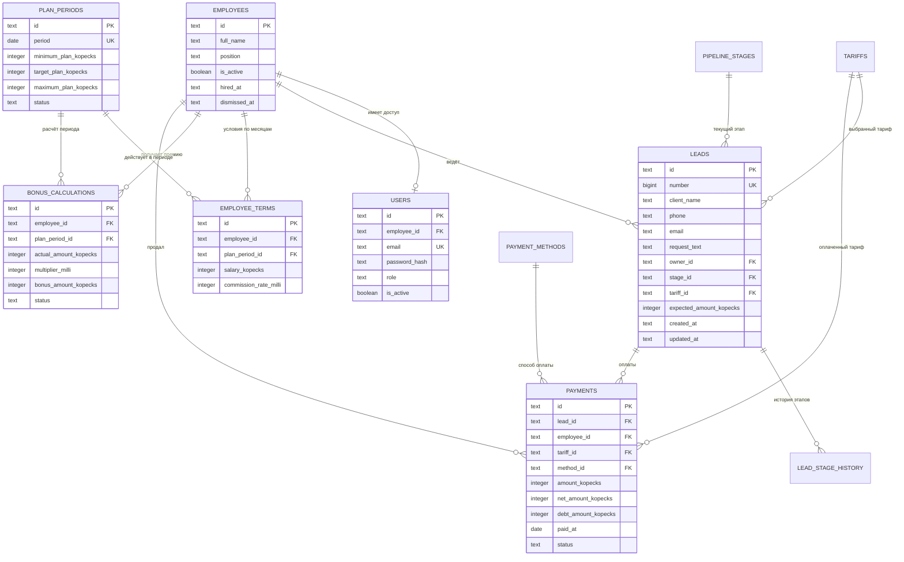

# Схема базы данных FinFlow CRM

## Выбор базы

Для проекта используется **SQLite 3**. Для локальной учебной CRM это даст простой запуск без отдельного сервера, один переносимый файл базы и полноценные транзакции. Для корректной работы связей при каждом подключении необходимо выполнять `PRAGMA foreign_keys = ON`.

Деньги хранятся целым числом копеек в `INTEGER`, чтобы избежать ошибок округления `REAL`. Ставки и коэффициенты также хранятся масштабированными целыми числами: например, `4500` означает `4,500%`. Даты хранятся в `TEXT` в ISO 8601 (`YYYY-MM-DD` или UTC `YYYY-MM-DDTHH:MM:SSZ`). Отчётный месяц хранится как строка `YYYY-MM-01`.

Рекомендуемые настройки соединения:

```sql
PRAGMA foreign_keys = ON;
PRAGMA journal_mode = WAL;
PRAGMA busy_timeout = 5000;
```

## Основные принципы

- Пользователь связан с сотрудником, но сотрудник может существовать без доступа в систему.
- Заявка хранит текущий этап, а каждое перемещение дополнительно записывается в историю.
- Одна заявка может иметь несколько платежей.
- Выручка, чистое поступление и дебиторская задолженность не смешиваются.
- План компании и условия сотрудника сохраняются отдельно для каждого месяца.
- Премия фиксируется в закрытом расчётном периоде, чтобы последующие изменения правил не меняли прошлые начисления.
- Справочники тарифов, этапов и способов оплаты не зашиваются в интерфейс.

## ER-диаграмма



## Таблицы

### `employees` — сотрудники

| Поле | Тип | Ограничения | Назначение |
|---|---|---|---|
| `id` | `TEXT` | PK, UUID генерируется приложением | Идентификатор сотрудника |
| `full_name` | `text` | NOT NULL | Имя в CRM |
| `position` | `text` | NOT NULL | Должность |
| `is_active` | `boolean` | DEFAULT true | Доступность в фильтрах и назначениях |
| `hired_at` | `date` | | Дата приёма |
| `dismissed_at` | `date` | | Дата увольнения |
| `created_at` | `TEXT` | NOT NULL | UTC-дата в ISO 8601 |

Сотрудники не удаляются физически: после увольнения выставляется `is_active = false`. Это сохраняет историю заявок и оплат.

### `users` — учётные записи

| Поле | Тип | Ограничения |
|---|---|---|
| `id` | `TEXT` | PK |
| `employee_id` | `TEXT` | FK → `employees.id`, UNIQUE |
| `email` | `TEXT COLLATE NOCASE` | UNIQUE, NOT NULL |
| `password_hash` | `text` | NOT NULL |
| `role` | `text` | CHECK (`manager`, `director`, `admin`) |
| `is_active` | `boolean` | DEFAULT true |
| `last_login_at` | `TEXT` | ISO 8601 |

Пароли хранятся только как Argon2id/bcrypt-хеши. В дальнейшем роли можно вынести в RBAC-таблицы, если появятся более сложные права.

### `pipeline_stages` — этапы Kanban

| Поле | Тип | Ограничения |
|---|---|---|
| `id` | `TEXT` | PK |
| `code` | `text` | UNIQUE, NOT NULL |
| `name` | `text` | NOT NULL |
| `sort_order` | `smallint` | UNIQUE, NOT NULL |
| `color` | `varchar(7)` | |
| `is_won` | `boolean` | DEFAULT false |
| `is_closed` | `boolean` | DEFAULT false |

Начальные значения: `new`, `work`, `proposal`, `paid`, `closed`.

### `tariffs` — тарифы

| Поле | Тип | Ограничения |
|---|---|---|
| `id` | `TEXT` | PK |
| `code` | `text` | UNIQUE, NOT NULL |
| `name` | `text` | NOT NULL |
| `base_price_kopecks` | `INTEGER` | CHECK ≥ 0 |
| `is_active` | `boolean` | DEFAULT true |

Тариф не удаляется, если участвовал в продаже: он переводится в архив.

### `leads` — заявки

| Поле | Тип | Ограничения |
|---|---|---|
| `id` | `TEXT` | PK |
| `number` | `INTEGER` | UNIQUE, выдаётся приложением или отдельной sequence-таблицей |
| `client_name` | `text` | NOT NULL |
| `phone` | `text` | |
| `email` | `TEXT COLLATE NOCASE` | |
| `income_range` | `text` | |
| `request_text` | `text` | |
| `comment` | `text` | |
| `owner_id` | `TEXT` | FK → `employees.id`, NOT NULL |
| `stage_id` | `TEXT` | FK → `pipeline_stages.id`, NOT NULL |
| `tariff_id` | `TEXT` | FK → `tariffs.id` |
| `expected_amount_kopecks` | `INTEGER` | CHECK ≥ 0 |
| `next_contact_at` | `TEXT` | ISO 8601 |
| `created_at` | `TEXT` | NOT NULL, ISO 8601 |
| `updated_at` | `TEXT` | NOT NULL, ISO 8601 |
| `closed_at` | `TEXT` | ISO 8601 |

### `lead_stage_history` — история Kanban

| Поле | Тип | Ограничения |
|---|---|---|
| `id` | `TEXT` | PK |
| `lead_id` | `TEXT` | FK → `leads.id`, NOT NULL |
| `from_stage_id` | `TEXT` | FK → `pipeline_stages.id` |
| `to_stage_id` | `TEXT` | FK → `pipeline_stages.id`, NOT NULL |
| `changed_by` | `TEXT` | FK → `users.id`, NOT NULL |
| `changed_at` | `TEXT` | NOT NULL, ISO 8601 |

Эта таблица позволяет считать конверсию, время на этапе и историю действий.

### `payment_methods` — способы оплаты

Поля: `id`, уникальный `code`, `name`, `is_active`. Начальные значения: полная оплата и рассрочка.

### `payments` — денежные операции

| Поле | Тип | Ограничения |
|---|---|---|
| `id` | `TEXT` | PK |
| `lead_id` | `TEXT` | FK → `leads.id`, NOT NULL |
| `employee_id` | `TEXT` | FK → `employees.id`, NOT NULL |
| `tariff_id` | `TEXT` | FK → `tariffs.id`, NOT NULL |
| `method_id` | `TEXT` | FK → `payment_methods.id`, NOT NULL |
| `amount_kopecks` | `INTEGER` | CHECK > 0 |
| `net_amount_kopecks` | `INTEGER` | CHECK ≥ 0 |
| `debt_amount_kopecks` | `INTEGER` | CHECK ≥ 0 |
| `paid_at` | `date` | NOT NULL |
| `status` | `text` | CHECK (`planned`, `partial`, `paid`, `refunded`, `cancelled`) |
| `external_reference` | `text` | UNIQUE, NULL допустим |
| `created_by` | `TEXT` | FK → `users.id` |
| `created_at` | `TEXT` | NOT NULL, ISO 8601 |

Ограничение: `net_amount_kopecks <= amount_kopecks`, а задолженность не должна быть отрицательной. Возвраты лучше хранить отдельной операцией или отдельной таблицей `refunds`, а не изменять исходную оплату.

### `plan_periods` — планы по месяцам

| Поле | Тип | Ограничения |
|---|---|---|
| `id` | `TEXT` | PK |
| `period` | `TEXT` | UNIQUE, формат `YYYY-MM-01` |
| `minimum_plan_kopecks` | `INTEGER` | CHECK ≥ 0 |
| `target_plan_kopecks` | `INTEGER` | CHECK ≥ `minimum_plan_kopecks` |
| `maximum_plan_kopecks` | `INTEGER` | CHECK ≥ `target_plan_kopecks` |
| `status` | `text` | CHECK (`draft`, `active`, `closed`) |
| `created_by` | `TEXT` | FK → `users.id` |
| `updated_at` | `TEXT` | NOT NULL, ISO 8601 |

### `employee_terms` — условия сотрудников по месяцам

| Поле | Тип | Ограничения |
|---|---|---|
| `id` | `TEXT` | PK |
| `employee_id` | `TEXT` | FK → `employees.id` |
| `plan_period_id` | `TEXT` | FK → `plan_periods.id` |
| `salary_kopecks` | `INTEGER` | CHECK ≥ 0 |
| `commission_rate_milli` | `INTEGER` | CHECK BETWEEN 0 AND 100000 |
| `created_by` | `TEXT` | FK → `users.id` |
| `updated_at` | `TEXT` | NOT NULL, ISO 8601 |

Уникальное ограничение: `(employee_id, plan_period_id)`. Изменение февраля не влияет на январь.

### `bonus_rules` — шкала коэффициентов

| Поле | Тип | Назначение |
|---|---|---|
| `id` | `TEXT` | PK |
| `plan_period_id` | `TEXT` | Период действия |
| `threshold_type` | `text` | `minimum`, `target`, `maximum` |
| `multiplier_milli` | `INTEGER` | Коэффициент × 1000, например `1350` = 1,35 |

Так правила `1.15 / 1.35 / 1.60` можно менять по месяцам без правки кода.

### `bonus_calculations` — зафиксированные начисления

| Поле | Тип | Ограничения |
|---|---|---|
| `id` | `TEXT` | PK |
| `employee_id` | `TEXT` | FK → `employees.id` |
| `plan_period_id` | `TEXT` | FK → `plan_periods.id` |
| `actual_amount_kopecks` | `INTEGER` | NOT NULL |
| `commission_rate_milli` | `INTEGER` | Снимок ставки × 1000 |
| `multiplier_milli` | `INTEGER` | Снимок коэффициента × 1000 |
| `bonus_amount_kopecks` | `INTEGER` | NOT NULL |
| `salary_amount_kopecks` | `INTEGER` | Снимок оклада |
| `total_amount_kopecks` | `INTEGER` | Оклад + премия |
| `status` | `text` | `preview`, `approved`, `paid` |
| `calculated_at` | `TEXT` | NOT NULL, ISO 8601 |
| `approved_by` | `TEXT` | FK → `users.id` |

Уникальное ограничение: `(employee_id, plan_period_id)`. До закрытия месяца запись можно пересчитывать, после утверждения — только сторнировать и создать корректировку.

## Расчёт показателей

```text
Факт менеджера = SUM(payments.net_amount_kopecks)
  для оплаченных операций сотрудника в выбранном месяце

Премия в копейках = ROUND(факт × ставка_milli × коэффициент_milli / 100000000)

К выплате = оклад + премия

Дебиторская задолженность = SUM(payments.debt_amount_kopecks)
Чистая прибыль = SUM(payments.net_amount_kopecks)
Выручка = SUM(payments.amount_kopecks)
```

Для финансовых отчётов месяц определяется по `paid_at`, а не по дате создания заявки.

## Индексы

```sql
CREATE INDEX leads_owner_stage_idx
    ON leads (owner_id, stage_id, created_at DESC);

CREATE INDEX leads_tariff_idx
    ON leads (tariff_id) WHERE tariff_id IS NOT NULL;

CREATE INDEX payments_paid_at_idx
    ON payments (paid_at DESC);

CREATE INDEX payments_employee_period_idx
    ON payments (employee_id, paid_at DESC)
    WHERE status IN ('partial', 'paid');

CREATE INDEX payments_tariff_method_idx
    ON payments (tariff_id, method_id);

CREATE INDEX stage_history_lead_date_idx
    ON lead_stage_history (lead_id, changed_at DESC);
```

Для полнотекстового поиска по имени, запросу и комментариям можно добавить виртуальную таблицу **FTS5**. Для email используется `COLLATE NOCASE`, а нормализованный телефон лучше хранить в отдельном индексированном поле.

## Транзакции и права

- Перемещение заявки и добавление строки истории выполняются одной транзакцией.
- Создание оплаты и перевод заявки в успешный этап также выполняются одной транзакцией.
- Менеджер видит и изменяет только назначенные ему заявки и свои показатели.
- Руководитель видит всю команду и редактирует планы и условия.
- Изменения планов, ставок, оплат и начислений стоит писать в `audit_log` с полями `actor_id`, `entity_type`, `entity_id`, `action`, `before`, `after`, `created_at`.

## Очерёдность реализации

1. `employees`, `users`, справочники и `leads`.
2. `lead_stage_history` и Kanban API.
3. `payments` и фильтруемая финансовая таблица.
4. `plan_periods`, `employee_terms`, `bonus_rules`.
5. `bonus_calculations`, закрытие месяца и аудит.
6. Обычные представления или отдельные агрегатные таблицы для аналитики — только после измерения реальной нагрузки.
